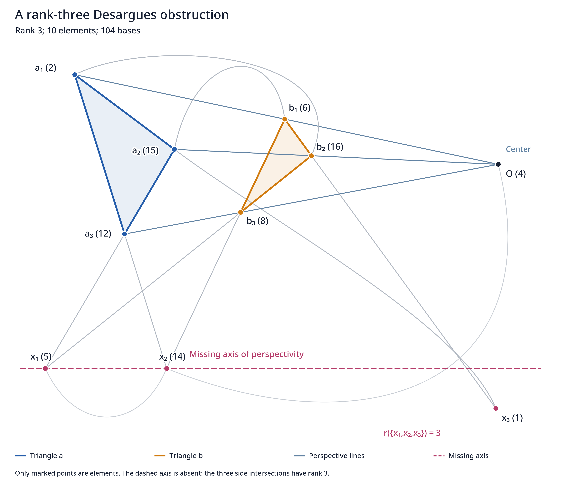

# Larson-Le verification

One Python program recomputes six Ingleton-Main (IM) extensions of Larson-Le's
rank-four dual matroid, contracts one element, and determines all 1,024 ranks
of a ten-element restriction by linear programming. It then checks the matroid
rank axioms and a violation of planar Desargues. Together with the mathematical
extension and minor theorems described below, this certifies that the starting
matroid is not almost entropic.

The LP computation and its input data are in [`im_projection.py`](im_projection.py).
The program needs no input files, saved certificates, SageMath, or Anaconda.
It follows a fixed sequence of six extensions; it does not repeat the search
that discovered that sequence.

## Proof outline

### The starting matroid

Let `N` be Larson-Le's rank-six algebraic matroid on `E = {1,...,10}`
([LL], Example 1.3). Over the rational function field
`F_2(t_1,...,t_6)`, its elements are the following functions, with the indicated
labels:

```text
1:  t_1
2:  t_2
3:  t_3
4:  t_1*t_2*t_3*(t_4+t_6)
5:  t_1*t_3*(t_4+t_5+t_6)
6:  t_1^2*t_2*t_3*(t_4+t_5)
7:  t_1*t_2*(t_5+t_6)
8:  t_4
9:  t_5
10: t_6
```

The rank of a subset is the transcendence degree of its functions over `F_2`.
We start the extension argument with **`D = N*`**, its rank-four dual, using
the same labels. Thus `r_D(A) = |A| - 6 + r_N(E \ A)`. Its bases are all
four-subsets of `E` except these 20 non-bases ([LL], equation (1)):

```text
{1,2,3,4}   {1,2,5,6}   {1,3,6,7}   {2,3,5,7}   {2,4,6,7}
{2,5,8,9}   {2,5,8,10}  {2,5,9,10}  {2,8,9,10}  {3,4,5,6}
{3,4,5,8}   {3,4,6,8}   {3,5,6,8}   {4,5,6,8}   {4,5,7,10}
{4,6,9,10}  {4,7,8,9}   {5,6,7,9}   {5,8,9,10}  {6,7,8,10}
```

The [Macaulay2 check below](#independent-algebraic-representation-check)
recovers these data directly from the functions. Matúš's theorem [M24] says
that algebraic matroids are almost entropic, so `N` is almost entropic. We
prove that `D` is not almost entropic by assuming the opposite and deriving
a Desargues contradiction.

### Six almost-entropic Ingleton-Main extensions

The extension fact we use is a statement about **real-valued polymatroids**.
If an almost-entropic rank function `h` satisfies

$$
h(L_i)=2,\qquad h(L_i\cup L_j)=3\ (i\ne j),\qquad
h(L_1\cup L_2\cup L_3)=4,
$$

it admits an almost-entropic extension by an element `z` such that

$$
h(z)=1,\qquad h(L_i\cup\{z\})=h(L_i)\quad(i=1,2,3).
$$

This follows from the almost-entropic Ahlswede-Körner extension property and
its three-line consequence in [BFP], Propositions 3.13 and 3.16. The new
element is in the closure of each of the three lines. The resulting extension
need not be a matroid; no integrality assumption is made.

Starting with `h_0 = r_D`, perform the following extensions in order:

| New element | First line | Second line | Third line |
| --- | --- | --- | --- |
| 11 | {4,6} | {5,8} | {9,10} |
| 12 | {4,8} | {5,6} | {7,9} |
| 13 | {2,11} | {4,7} | {5,10} |
| 14 | {4,5} | {6,8} | {7,10} |
| 15 | {1,2} | {3,4} | {5,6} |
| 16 | {1,6} | {2,5} | {3,7} |

Before each step, the program proves all seven rank premises by exact lower
and upper bounds derived from the current LP. These premises hold for every
polymatroid allowed by the preceding constraints, so in particular for each
almost-entropic extension supplied by the theorem. Fractional possibilities
remain in the LP whenever their ranks are not forced. There is no branching
over integral matroid extensions.

### The exact minor

Let `h_6` be the extension on `{1,...,16}`. Contract element **13** and restrict
to

$$
T=\{1,2,4,5,6,8,12,14,15,16\}.
$$

Equivalently, contract `{13}` and delete `{3,7,9,10,11}`. The resulting rank
function is

$$
g(S)=h_6(S\cup\{13\})-h_6(\{13\})
    =h_6(S\cup\{13\})-1\qquad(S\subseteq T).
$$

Restriction and contraction preserve almost entropicity; see [M18]. For
contraction, conditional entropy vectors are averages of entropy vectors,
hence belong to the closed convex almost-entropic cone, and the contraction
map is continuous. Thus `g` would be almost entropic.

The computation determines **all 1,024 values of `g` uniquely** and checks
that they are the ranks of a simple rank-three matroid `M`. This conclusion
is about the minor: the ambient `h_6` still has undetermined ranks.

### Bases and lines of the final matroid

The complete list of **104 bases** is in
[`data/final_matroid.json`](data/final_matroid.json). Equivalently, the bases
are **all three-subsets of `T` except the following 16 triples**:

```text
{1,2,15}  {1,6,16}  {2,4,6}   {2,5,8}
{2,5,16}  {2,8,16}  {2,12,14} {4,5,14}
{4,8,12}  {4,15,16} {5,6,12}  {5,6,15}
{5,8,16}  {5,12,15} {6,8,14}  {6,12,15}
```

Its ten lines containing at least three points are exactly

```text
{1,2,15}     {1,6,16}    {2,4,6}    {2,5,8,16} {2,12,14}
{4,5,14}     {4,8,12}    {4,15,16}  {5,6,12,15} {6,8,14}
```

Every other line contains just two points. The two four-point lines each
account for four dependent triples; the other eight lines each account for
one. Hence the number of bases is `binomial(10,3) - 2*4 - 8 = 104`.

### The Desargues violation

Use the following labels for two triangles, their perspective center, and
their corresponding side intersections:

$$
O=4,\quad (a_1,a_2,a_3)=(2,15,12),\quad
(b_1,b_2,b_3)=(6,16,8),\quad (x_1,x_2,x_3)=(5,14,1).
$$

Both triangles have rank three, every point has rank one, and every distinct
pair has rank two. These nine triples all have rank two:

| Incidence | Actual triple |
| --- | --- |
| `O, a_1, b_1` | {4,2,6} |
| `O, a_2, b_2` | {4,15,16} |
| `O, a_3, b_3` | {4,12,8} |
| `a_2, a_3, x_1` | {15,12,5} |
| `b_2, b_3, x_1` | {16,8,5} |
| `a_1, a_3, x_2` | {2,12,14} |
| `b_1, b_3, x_2` | {6,8,14} |
| `a_1, a_2, x_3` | {2,15,1} |
| `b_1, b_2, x_3` | {6,16,1} |

Yashfe's almost-entropic Desargues theorem [Y], Theorem 18 with the planar
case in Remark 19, would force `x_1,x_2,x_3` to be collinear. The clause for
an already existing third intersection applies because `x_3 = 1` is already
an element and all distinct pairs are independent. However, the computed rank is

$$
\boxed{g(\{x_1,x_2,x_3\})=g(\{1,5,14\})=3,\quad\text{not }2.}
$$

This contradiction proves that `D = N*` is not almost entropic, while its
algebraic dual `N` is almost entropic. The use of Remark 19 is justified by
the complete matroid-rank check on the minor, not by an integrality assumption
on the six intermediate extensions.

## Drawing the matroid



The two triangles have blue and orange outlines and light fills. Their three
slate-blue perspective lines meet at `O` on the right. The side extensions
descend toward an axis below the triangles, following the arrangement in
[Wikipedia's Desargues diagram](https://en.wikipedia.org/wiki/Desargues%27s_theorem).
The **rose dashed guide shows the missing Desargues axis**: `x_1 = 5` and
`x_2 = 14` lie on it, while `x_3 = 1` sits visibly below it. Their triple has
rank three. The dashed guide is an annotation, not a matroid line; the actual
rank-two flat through `x_1` and `x_2` is `{4,5,14}`, drawn as a light-gray curve.

The triangle boundaries are straight and prominent, while their extensions
are lighter. Curved extensions record the extra incidences on the two
four-point lines and the failure of Desargues.

All ten nontrivial rank-two flats are drawn. Following the incidence-diagram
convention in [O], curves record flats and only marked points are elements;
unmarked crossings create no additional incidence. This is a schematic
geometric representation of an abstract matroid. The curves need not
be straight Euclidean lines.

The repository contains the [SVG](figures/final_matroid.svg), a **3540 × 2940
transparent PNG** ([download](figures/final_matroid.png)), and the complete
[layout](figures/final_layout.json). The figure uses explicit vector paths
and hand-placed coordinates; no graph-layout engine is involved.

[`draw_matroid.py`](draw_matroid.py) computes the flats from a complete basis
list and creates the drawing. SVG generation uses only the Python standard
library. PNG export additionally uses [CairoSVG](https://cairosvg.org/documentation/);
install the optional dependency in your virtual environment:

```sh
python -m pip install ".[drawing]"
```

CairoSVG requires the Cairo system library; its linked installation guide
covers platform-specific prerequisites. To reproduce both checked-in images
from the repository directory, run this command on one line:

```sh
python draw_matroid.py data/final_matroid.json --layout figures/final_layout.json --output figures/final_matroid.svg --png figures/final_matroid.png --scale 3
```

After rerunning the LP computation, regenerate the basis data directly from
its complete rank table with:

```sh
python draw_matroid.py im_projection_output/projection.csv --write-json data/final_matroid.json --layout figures/final_layout.json --output figures/final_matroid.svg --png figures/final_matroid.png --title "A rank-three Desargues obstruction"
```

The CSV reader requires exact matching integer bounds, checks the basis
axioms, and checks that the resulting matroid reproduces every input rank.
The LP verifier computes everything afresh and never reads this saved basis
file or the layout.

For other small matroids, supply a JSON file of the following form, with
integer element labels and **all** bases:

```json
{"name": "U(3,4)", "ground_set": [1,2,3,4],
 "bases": [[1,2,3], [1,2,4], [1,3,4], [2,3,4]]}
```

Then run `python draw_matroid.py your_matroid.json --output your_matroid.svg`.
The installed `draw-matroid` command is equivalent. A circular layout is used
by default; a separate layout file can set coordinates, labels, colors, and
cubic Bezier controls. Solid lines are always computed from the matroid, and
a layout claiming a nonexistent flat is rejected. Dashed guides are explicitly
separate annotations.

The renderer supports ranks zero through four, including loops and parallel
elements. Parallel elements share a labeled point; loops are listed separately.
For rank four, an overview shows the lines and separate shaded panels show
every rank-three flat with at least four geometric points. Three-point planes
are implicit. This makes plane membership explicit without relying on a
possibly misleading perspective projection. The automatic layout prioritizes
incidence correctness; a hand-tuned layout improves crowded examples.
The renderer contains no Desargues-specific logic or fixed element labels. All
presentation choices for this example are in `figures/final_layout.json`;
its Desargues rank checks belong to the verifier and the example's tests.

## Install and run

Use Python 3.10 or newer with `pip` and `venv`. The two runtime dependencies are
NumPy and the HiGHS Python interface, `highspy`. Installation reads their versions
from [`pyproject.toml`](pyproject.toml) and installs them automatically. HiGHS is
pinned to 1.16.0, the solver version used for verification.

Download or copy this repository, then open a terminal in its directory.

On Linux or macOS:

```sh
python3 -m venv .venv
. .venv/bin/activate
python -m pip install .
larson-le-verify
```

On Windows, using PowerShell:

```powershell
py -m venv .venv
.\.venv\Scripts\python.exe -m pip install .
.\.venv\Scripts\larson-le-verify.exe
```

The virtual environment keeps the dependencies local to this installation.
The first installation needs access to the Python package index; computation
after installation is offline.

With the environment's Python, these are equivalent ways to run the program:

```sh
python -m im_projection
python im_projection.py
```

The second form requires the script in the current directory. You can also copy
just that file to a computer where the declared NumPy and HiGHS versions are
already installed. Python's standard library alone is insufficient.

Assertions are part of the verification: run without `python -O` or
`PYTHONOPTIMIZE`. The command refuses to run if assertions are disabled.

## Output

The default output directory is `im_projection_output` in the current directory.
To choose another directory and also export the six LP models:

```sh
larson-le-verify --output results --write-lps
```

On Windows, use `.\.venv\Scripts\larson-le-verify.exe` for the command above.
Reusing an output directory overwrites files with the same names.

* `extensions.json` records the six extension triples, the verified premises,
  and exact rational bounds for the closed sets after each compression.
* `projection.csv` records all 1,024 lower and upper rank bounds after contracting
  element 13 and restricting to `(1, 2, 4, 5, 6, 8, 12, 14, 15, 16)`. Bit `i` of
  `local_mask` denotes position `i` in that list, counting from zero. The `points`
  column uses the original element labels.
* With `--write-lps`, `extension_11.lp` through `extension_16.lp` contain the
  extension models before compression. Their objectives are zero; the program
  changes objectives while finding rank bounds.

A successful run ends by reporting that all nine Desargues collinear triples
have rank two, while the three proposed axis points have rank three. It also
reports 1,775 LP solves, including feasibility checks. Failure of a verification
check terminates the program with a nonzero exit status.

## What is checked

Unknown ranks are real variables throughout. The program imposes polymatroid
inequalities, verifies each extension's premises, and only identifies sets or
fixes ranks when exact lower and upper bounds coincide. Intermediate fractional
possibilities are retained.

HiGHS finds floating-point solutions. The program reconstructs rational feasible
points and checks their inequalities exactly. It also reconstructs nonnegative
dual multipliers and uses exact rational arithmetic and column bounds to obtain
valid objective bounds. Equality is certified by matching exact bounds, without
rounding ranks to integers. The final restriction is checked to have integral
ranks and satisfy the matroid rank axioms.

The LPs impose Shannon inequalities, which are necessary conditions for almost
entropicity. The extension, minor, and Desargues theorems in the proof outline
are mathematical inputs, not claims proved by the solver.

## Independent algebraic representation check

[`algebraic_dual.m2`](algebraic_dual.m2) starts directly from the ten functions in
Larson-Le, Example 1.3. It computes all bases of their rank-six algebraic matroid
and then its rank-four dual. It does not read the Python non-basis list.

This optional check requires [Macaulay2](https://macaulay2.com/) with its
[`Matroids` package](https://macaulay2.com/doc/Macaulay2/share/doc/Macaulay2/Matroids/html/index.html),
installed separately from the Python dependencies. From the repository directory:

```sh
mkdir -p algebraic_output
cd algebraic_output
M2 --script ../algebraic_dual.m2
cd ..
```

The script forms the graph ideal `(x_i - f_i(t))` over the field with two
elements and eliminates all six parameters. For each of the 210 six-subsets
of the output coordinates, it eliminates the four complementary coordinates.
The resulting ideal is zero exactly when that six-subset is algebraically
independent. This tests algebraic independence directly, including inseparable
dependencies in characteristic two. The `Matroids` package constructs the
matroid from these bases, checks it, and takes its dual.

Outputs in `algebraic_output/` are:

* `dual_bases.csv`: all 190 bases of the dual, using the paper's labels 1 through 10.
* `dual_nonbases.csv`: its 20 non-bases, which agree with `NONBASES` in the verifier.
* `kernel.m2`: the eliminated ideal of relations among the ten functions.
* `eliminations.tsv`: all 210 independence tests and their elimination ideals.

This computation was checked with Macaulay2 1.25.11 and Matroids 1.7.0.

## Tested environment and resources

A fresh installation on Linux x86-64 with Python 3.13.9, NumPy 2.5.4, and
HiGHS 1.16.0 passed the complete verification and exported all six LP models.
On an Intel Core i5-1335U, that run took 73.6 seconds and peaked at 480 MiB of
resident memory. HiGHS uses one solver thread. Runtime varies with hardware.
These measurements include recomputing everything from the embedded initial
matroid and extension triples; no saved results were loaded.
The figure export was also checked in an isolated environment with CairoSVG
2.9.1, including its transparent alpha channel.

## Packaging

This is a small setuptools distribution using the standard
[`pyproject.toml` format](https://packaging.python.org/en/latest/guides/writing-pyproject-toml/)
for dependency metadata. `pip install .` installs the verifier, the drawing
helper, and the `larson-le-verify` and `draw-matroid` commands. PNG rendering
dependencies are optional. No separate `setup.py` or dependency list is needed.

The drawing and input-validation tests use the standard-library test runner:

```sh
python -m unittest discover -s tests -v
```

To build a wheel and source archive for distribution, run these commands in an
activated virtual environment:

```sh
python -m pip install build
python -m build
```

The files appear in `dist/`. Someone receiving the wheel can install it with
`python -m pip install path/to/larson_le_verification-0.1.0-py3-none-any.whl`;
pip will also install its dependencies.
The source archive additionally includes the Macaulay2 script, basis data,
layout, both figure formats, and tests.

## References

* **LL.** Matt Larson and Tuong Le, *Duals of algebraic matroids need not be
  algebraic* (2026), [arXiv:2609.02834v1][LL]. Example 1.3 gives the algebraic
  representation; equation (1) specifies the dual's non-bases.
* **BFP.** Michael Bamiloshin, Oriol Farràs and Carles Padró, *A note on extension
  properties and representations of matroids*, Discrete Applied Mathematics
  **376** (2025), 270–280. [DOI:10.1016/j.dam.2025.06.028][BFP].
  Propositions 3.13 and 3.16 supply the almost-entropic three-line extension
  used here. [Open-access manuscript](https://repositori.urv.cat/repositori/getDocument/imarina:9462591?ds=DocumentPrincipal&mime=application/pdf).
* **Y.** Geva Yashfe, *On the recognition problem for limits of entropy
  functions* (2025), [arXiv:2509.06302v1][Y]. Theorem 18 and Remark 19 supply
  the almost-entropic Desargues obstruction, including the planar case.
* **M24.** František Matúš, *Algebraic matroids are almost entropic*, Proceedings
  of the American Mathematical Society **152** (2024), 1–6.
  [DOI:10.1090/proc/13846][M24], Theorem 1.
  [Author manuscript](https://staff.utia.cas.cz/matus/algaent.pdf).
* **M18.** František Matúš, *Classes of matroids closed under minors and principal
  extensions*, Combinatorica **38** (2018), 935–954.
  [DOI:10.1007/s00493-017-3534-y][M18]. Background on the almost-entropic class
  and minor operations. [Author manuscript](https://staff.utia.cas.cz/matus/FINmatpriext.pdf).
* **O.** James Oxley, *Matroid Theory*, second edition, Oxford University Press
  (2011), §1.5, “Geometric representations of matroids of small rank”.
  [Book DOI][O]. See also his openly available
  [*What is a matroid?*](https://www.math.lsu.edu/~oxley/survey4.pdf) for geometric
  diagrams of small-rank matroids.

[LL]: https://arxiv.org/html/2609.02834v1
[BFP]: https://doi.org/10.1016/j.dam.2025.06.028
[Y]: https://arxiv.org/html/2509.06302v1
[M24]: https://doi.org/10.1090/proc/13846
[M18]: https://doi.org/10.1007/s00493-017-3534-y
[O]: https://doi.org/10.1093/acprof:oso/9780198566946.001.0001
