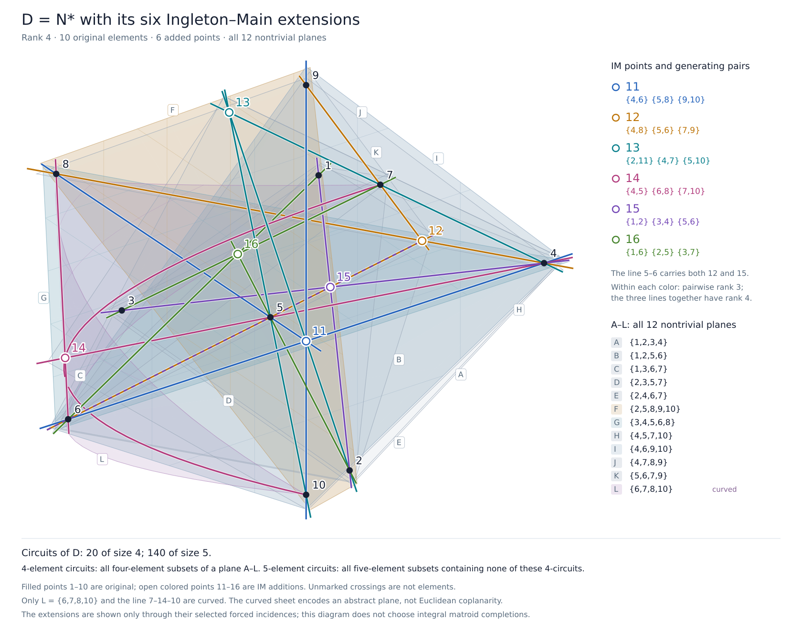

# Larson-Le verification

---

**Human note: This repository contains a program which is supposed to verify
that the dual of the Larson-Le matroid is not almost-entropic. Up to this
point no human has read this program and verified that it is correctly implemented.**

---

One Python program recomputes six Ingleton-Main (IM) extensions of Larson-Le's
rank-four dual matroid, contracts one element, and determines all 1,024 ranks
of a ten-element restriction by exact rank inequalities. It then checks the matroid
rank axioms and a violation of planar Desargues. Together with the mathematical
extension and minor theorems described below, this certifies that the starting
matroid is not almost entropic.

The verification and its input data are in [`im_projection.py`](im_projection.py).
The program needs only Python's standard library: no input files, saved
certificates, numerical solver, or computer algebra system.
It follows a fixed sequence of six extensions; it does not repeat the search
that discovered that sequence.

## Proof outline

### The starting matroid

Let `N` be Larson-Le's rank-six algebraic matroid on `E = {1,...,10}`
([LL], Example 1.3). Over the rational function field
`F_2(t_1,...,t_6)`, its elements are the following functions, with the indicated
labels:

```text
1:  t_1
2:  t_2
3:  t_3
4:  t_1*t_2*t_3*(t_4+t_6)
5:  t_1*t_3*(t_4+t_5+t_6)
6:  t_1^2*t_2*t_3*(t_4+t_5)
7:  t_1*t_2*(t_5+t_6)
8:  t_4
9:  t_5
10: t_6
```

The rank of a subset is the transcendence degree of its functions over `F_2`.
We start the extension argument with **`D = N*`**, its rank-four dual, using
the same labels. Thus `r_D(A) = |A| - 6 + r_N(E \ A)`. Its bases are all
four-subsets of `E` except these 20 non-bases ([LL], equation (1)):

```text
{1,2,3,4}   {1,2,5,6}   {1,3,6,7}   {2,3,5,7}   {2,4,6,7}
{2,5,8,9}   {2,5,8,10}  {2,5,9,10}  {2,8,9,10}  {3,4,5,6}
{3,4,5,8}   {3,4,6,8}   {3,5,6,8}   {4,5,6,8}   {4,5,7,10}
{4,6,9,10}  {4,7,8,9}   {5,6,7,9}   {5,8,9,10}  {6,7,8,10}
```

The [Macaulay2 check below](#independent-algebraic-representation-check)
recovers these data directly from the functions. Matúš's theorem [M24] says
that algebraic matroids are almost entropic, so `N` is almost entropic. We
prove that `D` is not almost entropic by assuming the opposite and deriving
a Desargues contradiction.

### Six almost-entropic Ingleton-Main extensions

The extension fact we use is a statement about **real-valued polymatroids**.
If an almost-entropic rank function `h` satisfies

$$
h(L_i)=2,\qquad h(L_i\cup L_j)=3\ (i\ne j),\qquad
h(L_1\cup L_2\cup L_3)=4,
$$

it admits an almost-entropic extension by an element `z` such that

$$
h(z)=1,\qquad h(L_i\cup\{z\})=h(L_i)\quad(i=1,2,3).
$$

This follows from the almost-entropic Ahlswede-Körner extension property and
its three-line consequence in [BFP], Propositions 3.13 and 3.16. The new
element is in the closure of each of the three lines. The resulting extension
need not be a matroid; no integrality assumption is made.

Starting with `h_0 = r_D`, perform the following extensions in order:

| New element | First line | Second line | Third line |
| --- | --- | --- | --- |
| 11 | {4,6} | {5,8} | {9,10} |
| 12 | {4,8} | {5,6} | {7,9} |
| 13 | {2,11} | {4,7} | {5,10} |
| 14 | {4,5} | {6,8} | {7,10} |
| 15 | {1,2} | {3,4} | {5,6} |
| 16 | {1,6} | {2,5} | {3,7} |

Before each step, the program proves all seven rank premises by exact lower
and upper rank bounds. These premises hold for every polymatroid allowed by
the preceding constraints, so in particular for each
almost-entropic extension supplied by the theorem. Fractional possibilities
remain in the intervals whenever their ranks are not forced. There is no
branching over integral matroid extensions.

The [spatial drawing below](#spatial-drawing-of-the-rank-four-matroid) shows
all six triples and their common points together with the original planes.

### The exact minor

Let `h_6` be the extension on `{1,...,16}`. Contract element **13** and restrict
to

$$
T=\{1,2,4,5,6,8,12,14,15,16\}.
$$

Equivalently, contract `{13}` and delete `{3,7,9,10,11}`. The resulting rank
function is

$$
g(S)=h_6(S\cup\{13\})-h_6(\{13\})
    =h_6(S\cup\{13\})-1\qquad(S\subseteq T).
$$

Restriction and contraction preserve almost entropicity; see [M18]. For
contraction, conditional entropy vectors are averages of entropy vectors,
hence belong to the closed convex almost-entropic cone, and the contraction
map is continuous. Thus `g` would be almost entropic.

The computation determines **all 1,024 values of `g` uniquely** and checks
that they are the ranks of a simple rank-three matroid `M`. This conclusion
is about the minor: the ambient `h_6` still has undetermined ranks.

### Bases and lines of the final matroid

The complete list of **104 bases** is in
[`data/final_matroid.json`](data/final_matroid.json). Equivalently, the bases
are **all three-subsets of `T` except the following 16 triples**:

```text
{1,2,15}  {1,6,16}  {2,4,6}   {2,5,8}
{2,5,16}  {2,8,16}  {2,12,14} {4,5,14}
{4,8,12}  {4,15,16} {5,6,12}  {5,6,15}
{5,8,16}  {5,12,15} {6,8,14}  {6,12,15}
```

Its ten lines containing at least three points are exactly

```text
{1,2,15}     {1,6,16}    {2,4,6}    {2,5,8,16} {2,12,14}
{4,5,14}     {4,8,12}    {4,15,16}  {5,6,12,15} {6,8,14}
```

Every other line contains just two points. The two four-point lines each
account for four dependent triples; the other eight lines each account for
one. Hence the number of bases is `binomial(10,3) - 2*4 - 8 = 104`.

### The Desargues violation

Use the following labels for two triangles, their perspective center, and
their corresponding side intersections:

$$
O=4,\quad (a_1,a_2,a_3)=(2,15,12),\quad
(b_1,b_2,b_3)=(6,16,8),\quad (x_1,x_2,x_3)=(5,14,1).
$$

Both triangles have rank three, every point has rank one, and every distinct
pair has rank two. These nine triples all have rank two:

| Incidence | Actual triple |
| --- | --- |
| `O, a_1, b_1` | {4,2,6} |
| `O, a_2, b_2` | {4,15,16} |
| `O, a_3, b_3` | {4,12,8} |
| `a_2, a_3, x_1` | {15,12,5} |
| `b_2, b_3, x_1` | {16,8,5} |
| `a_1, a_3, x_2` | {2,12,14} |
| `b_1, b_3, x_2` | {6,8,14} |
| `a_1, a_2, x_3` | {2,15,1} |
| `b_1, b_2, x_3` | {6,16,1} |

The nondegenerate planar Desargues theorem proved in the next section forces
`x_1,x_2,x_3` to be collinear. Besides the incidences above, the program checks
`g(O,a_i,a_j) = 3` for every `i != j`, so corresponding sides are distinct.
The proof uses [Y], Lemma 16 and Theorem 18, and makes the lifting argument
suggested in Remark 19 explicit. Its final uniqueness argument applies to
the existing intersection `x_3 = 1`. However, the computed rank is

$$
\boxed{g(\{x_1,x_2,x_3\})=g(\{1,5,14\})=3,\quad\text{not }2.}
$$

This contradiction proves that `D = N*` is not almost entropic, while its
algebraic dual `N` is almost entropic. The complete matroid-rank and
nondegeneracy checks are on the minor; no integrality assumption is made
on the six intermediate extensions.

## A detailed planar Desargues proof

Here is an explicit version of the lift-and-project argument suggested in
[Y], Remark 19. We include a nondegeneracy hypothesis excluding coincident
corresponding sides. This hypothesis matters when intersection points are
prescribed; the counterexample at the end of this section explains why.
Our final matroid satisfies it even though two of its lines have four points.

### Statement and ingredients

Let `r` be the rank function of a simple almost-entropic rank-three matroid
on `E`, containing nine distinct points

$$
O,a_1,a_2,a_3,b_1,b_2,b_3,x_1,x_2.
$$

Assume both triangles have rank three, and assume

```math
\begin{aligned}
r(O,a_i,b_i)&=2 &&(i=1,2,3),\\
r(a_2,a_3,x_1)&=r(b_2,b_3,x_1)=2,\\
r(a_1,a_3,x_2)&=r(b_1,b_3,x_2)=2,\\
r(O,a_i,a_j)&=3 &&(1\leq i<j\leq3).
\end{aligned}
```

Then an almost-entropic polymatroid extension contains a point `z` with

$$
h(z)=1,\qquad
h(a_1,a_2,z)=h(b_1,b_2,z)=h(x_1,x_2,z)=2.
$$

If a rank-one point `t` already belongs to both corresponding side lines
`cl(a_1,a_2)` and `cl(b_1,b_2)`, then `r(x_1,x_2,t)=2`.

We use three established ingredients: the almost-entropic copy lemma
([Y], Lemma 16), the rank-four Desargues theorem ([Y], Theorem 18), and the
almost-entropic three-line extension property ([BFP], Propositions 3.13 and
3.16). In the last property, three rank-two sets whose pairwise unions have
rank three and whose total union has rank four acquire a common rank-one
point. These are statements about real-valued polymatroids.

Throughout the proof, `h` denotes the rank in the current extension, and
`cl` its closure. Juxtaposition denotes union, and
`h(S | T) = h(S T) - h(T)`. Later extensions preserve earlier ranks.

### 1. Copy three points into a second plane

Apply the copy lemma with base and copied set

$$
K=\{O,a_3,b_3\},\qquad U=\{a_2,b_2,x_1\},
$$

and call the new points `U' = {a_2',b_2',x_1'}`. We have `r(K)=2` and
`r(K,u)=3` for each `u` in `U`. For `a_2` this is a stated hypothesis;
for `b_2` it follows from the line `O,a_2,b_2`. For `x_1`, being on both
`cl(a_2,a_3)` and `cl(K)` would put `a_2` in `cl(K)`, a contradiction.
Here simplicity lets either distinct pair on a rank-two line span that line.

The copy lemma preserves the ranks on `K U` under the map `u -> u'`, and
makes `U'` independent from `E` conditionally on `K`. Consequently,

$$
h(EU')=3+3-2=4,\qquad h(KU')=3,
$$

and, for every `u` in `U`,

$$
h(u'\mid E)=1,\qquad h(u\mid KU')=1.
$$

Thus every copied point is independent from the old plane. In particular,
all pairs among the old and copied points have rank two. No assertion that
the entire extension is a matroid is needed.

### 2. Construct a point outside the old plane

Consider

$$
L_1=\{a_2,a_2'\},\quad
L_2=\{b_2,b_2'\},\quad
L_3=\{x_1,x_1'\}.
$$

Each has rank two. The original and copied incidences give

```math
\begin{aligned}
h(L_1L_2)&=h(O,a_2,a_2')=3,\\
h(L_1L_3)&=h(a_3,a_2,a_2')=3,\\
h(L_2L_3)&=h(b_3,b_2,b_2')=3.
\end{aligned}
```

For example, `a_2,b_2` recover `O`, and the lines through `O` recover the
other endpoints, proving the first closure equality. The others use `a_3`
and `b_3` in the same way. The union of all three lines spans
`O,a_3,a_2,a_2'`, which has rank four. The three-line extension property
therefore supplies a rank-one point

$$
p\in\mathrm{cl}(a_2,a_2')
 \cap\mathrm{cl}(b_2,b_2')
 \cap\mathrm{cl}(x_1,x_1').
$$

We will need `h(p,a_2)=h(p,a_2')=2`. Both follow from diminishing returns,
since `p` is in `cl(L_2)` and

$$
h(L_2,a_2)=h(L_2,a_2')=3.
$$

The first equality uses independence of `b_2'` from the old plane; the
second uses independence of `b_2` from the copied plane `K U'`. Explicitly,
for `v = a_2` or `a_2'`,

$$
h(p,v)-h(p)\geq h(L_2,v)-h(L_2)=1.
$$

Since `a_2'` belongs to `cl(a_2,p)`, we obtain `h(E,p)=4` and hence
`h(p | E)=1`: `p` is outside the old plane.

### 3. Apply the rank-four theorem to mixed triangles

Use the following substitution into [Y], Theorem 18:

| Role in that theorem | Point or ordered triple here |
| --- | --- |
| Perspective center | `O` |
| First triangle | `(a_2', a_1, a_3)` |
| Second triangle | `(b_2', b_1, b_3)` |
| First known side intersection | `x_2` |
| Second known side intersection | `x_1'` |

All nine points have rank one and all distinct pairs have rank two.
The three perspective incidences and four side incidences come directly
from the original configuration or its copied restriction. The rank-four
hypothesis is

$$
h(O,a_2',a_1,a_3)=r(O,a_1,a_3)+h(a_2'\mid O,a_1,a_3)=3+1=4.
$$

The theorem supplies a rank-one point

$$
q\in\mathrm{cl}(a_1,a_2')
 \cap\mathrm{cl}(b_1,b_2')
 \cap\mathrm{cl}(x_2,x_1'),
$$

and includes the conclusion `h(q,a_2')=2` (also `h(q,b_2')=2`).
This uses the rank-four theorem itself, not the planar remark.

### 4. Construct the missing intersection

First, `h(p,q)=2`. Indeed, the equalities
`h(p,a_2')=h(q,a_2')=2` imply

$$
a_2\in\mathrm{cl}(p,a_2'),\qquad
a_1\in\mathrm{cl}(q,a_2').
$$

Thus `h(p,q,a_2') >= h(a_1,a_2,a_2') = 3`, and subadditivity gives
`h(p,q) >= 2`; the reverse bound follows from the singleton ranks.

Now consider the three rank-two sets

$$
A=\{a_1,a_2\},\qquad B=\{b_1,b_2\},\qquad P=\{p,q\}.
$$

Their pairwise union ranks are all three. For `A B`, the union spans
`O,a_1,a_2`, which has rank three. For `A P`, all four points lie in
`cl(a_1,a_2,a_2')`, of rank three, and the rank is at least three because
`p` is independent from the old rank-two set `A`. The same argument for
`B P` uses `cl(b_1,b_2,b_2')`. Finally, `A B` spans the old plane and `p`
is outside it, so `h(A B P)=4`.

A second three-line extension supplies a rank-one point

$$
z\in\mathrm{cl}(a_1,a_2)
 \cap\mathrm{cl}(b_1,b_2)
 \cap\mathrm{cl}(p,q).
$$

In particular, `z` is in the closure of the old plane.

### 5. Project the collinearity back to the old plane

The set `{x_1,x_2,x_1'}` has rank three. Its closure contains `p`, because
`p` is on `cl(x_1,x_1')`, and `q`, because `q` is on `cl(x_2,x_1')`.
It therefore contains `z`. Consequently,

$$
h(x_1,x_2,z,x_1')=3.
$$

Since `z` is in `cl(E)` and `h(x_1' | E)=1`, diminishing returns gives
`h(x_1' | x_1,x_2,z)=1`. Subtracting yields

$$
h(x_1,x_2,z)=3-1=2.
$$

This proves the existence conclusion. The calculation uses exact rank
increments and submodularity; it never rounds a fractional rank or assumes
the copied or extended polymatroids are matroids.

### 6. Identify an already existing intersection

Suppose `t` is an existing rank-one point on both `cl(A)` and `cl(B)`.
Since `h(A)=h(B)=2` and `h(A B)=3`, submodularity gives

$$
h(z,t)\leq h(Azt)+h(Bzt)-h(ABzt)=2+2-3=1.
$$

Monotonicity gives the reverse inequality, so `h(z,t)=1`: the two points
have the same closure. Hence `r(x_1,x_2,t)=h(x_1,x_2,z)=2`.
This proves uniqueness up to parallelism even in a real-valued polymatroid
extension. The distinctness of the two side lines, expressed by `r(A B)=3`,
is essential here.

### Check on the computed matroid

The saved 1,024 exact ranks and the complete basis list agree on every
subset. They satisfy the matroid rank axioms. With the labels in the proof
outline, both triangles have rank three, all ten points have rank one,
and all 45 distinct pairs have rank two. The additional nondegeneracy
checks are

$$
g(4,2,15)=g(4,2,12)=g(4,15,12)=3.
$$

The complete corresponding side lines are:

| Intersection | First side flat | Second side flat | Intersection of the flats |
| --- | --- | --- | --- |
| `x_1 = 5` | `{5,6,12,15}` | `{2,5,8,16}` | `{5}` |
| `x_2 = 14` | `{2,12,14}` | `{6,8,14}` | `{14}` |
| `x_3 = 1` | `{1,2,15}` | `{1,6,16}` | `{1}` |

Each pair of side flats has union rank three. The four-point lines add
`b_1` to `cl(a_2,a_3)` and `a_1` to `cl(b_2,b_3)`; they do not identify
either pair of corresponding sides. The additional line `{4,5,14}` puts
`O` on `cl(x_1,x_2)`, which is also allowed: the proof never requires
`r(O,x_1,x_2)=3`.

For a completely concrete naming of the hypothetical extensions above:

| Operation | New points and incidences |
| --- | --- |
| Conditional copy | Copy `(15,16,5)` over `{4,12,8}` to `(17,18,19)` |
| First three-line extension | `20` on `{15,17}`, `{16,18}`, `{5,19}` |
| Rank-four Desargues | Center `4`, triangles `(17,2,12)` and `(18,6,8)`, known intersections `(14,19)`; obtain `21` on `{17,2}`, `{18,6}`, `{14,19}` |
| Second three-line extension | `22` on `{2,15}`, `{6,16}`, `{20,21}` |

The proof gives `h(5,14,22)=2` and `h(1,22)=1`, contradicting the computed
`g(1,5,14)=3`. These are hypothetical extensions under the assumption that
the final matroid is almost entropic; they are mathematical proof steps,
not additional operations performed by `im_projection.py`.

### Why the nondegeneracy condition is explicit

Read literally without excluding coincident sides, the rank-three
replacement in [Y], Remark 19 is too broad for prescribed intersection
points. A representable example already shows the issue. Over the field
with 101 elements, take the following projective columns:

```text
O : (2,0,1)     a_1: (0,1,1)     a_2: (0,0,1)     a_3: (1,0,1)
b_1: (2,1,2)   b_2: (3,0,1)     b_3: (4,0,1)
x_1: (5,0,1)   x_2: (2,3,5)     x_3: (0,3,4)
```

This is a simple rank-three matroid; both triangles have rank three and
all nine indicated incidence triples have rank two, but `r(x_1,x_2,x_3)=3`.
The problem is that `cl(a_2,a_3) = cl(b_2,b_3)`: the prescribed `x_1` was
chosen arbitrarily on that common line. In particular, `r(O,a_2,a_3)=2`.
Representable matroids are almost entropic, so this degeneracy cannot be
ignored. The verifier explicitly rejects it. Our proof above supplies the
nondegenerate version actually used here directly from the copy lemma,
the rank-four theorem, and the three-line extension property.

## Spatial drawing of the rank-four matroid



The single figure draws all 12 rank-three flats containing at least four
original points, labeled A–L, and all six IM points. Original elements are
filled black dots; added points are open colored circles. Each added point
shares its color with its three generating lines. The line through 5 and 6
contains both 12 and 15, so it alternates their two colors. Faint grids and
the order of overlapping sheets indicate their different spatial angles;
gaps at unmarked line crossings show which line passes behind.

The starting matroid has no three-point lines. Its **20 four-element circuits**
are exactly the four-element subsets of the 12 planes shown. Each five-point
plane contains five such circuits. Its **140 five-element circuits** are
exactly the five-element sets containing none of those four-element circuits.
This describes every circuit without drawing 140 overlapping spanning sets.
The complete circuit list is also embedded in the SVG's `matroid-circuits`
metadata, computed from the basis data when the figure is generated.

The rational spatial coordinates realize the matroid obtained by declaring
`{6,7,8,10}` a basis. Every other rank of an original subset is correct in
those coordinates. Restoring that set as an abstract plane therefore requires
the curved sheet: the picture is an incidence schematic, not a linear
representation of `D`.

For the selected IM incidences, 17 of the 18 line uses and 17 of the 18
pairwise plane uses are straight or flat in the spatial coordinates. The
exception is step 4: the line through
`7,14,10` curves within the ordinary plane `{4,5,7,10}` and also belongs to
the curved sheet L, `{6,7,8,10}`. All three lines of that color meet at 14.
Only this one original plane needs to be curved.

The added points display only the selected, forced incidences. They do not
choose integral completions or assert that the intermediate polymatroids
are matroids. Within each color, the three lines together have rank four,
while every pair has union rank three. Unmarked crossings are not elements.

Download the self-contained [interactive viewer](figures/rank4_interactive.html)
and open it in a browser to rotate the diagram, move between steps, and
isolate any of the three planes. Its **Original** view also allows selection
of each of the original 12 planes. It works offline and can export the current
view as an SVG. The combined static figure is available as
[SVG](figures/rank4_original.svg) and [PNG](figures/rank4_original.png), both
with a white background.

[`draw_im_steps.py`](draw_im_steps.py) reads the complete
[original basis data](data/dual_matroid.json), the
[selected extension incidences](data/im_steps.json), and a separate
[spatial layout](figures/im_spatial_layout.json). It checks the rational
coordinates against every original subset of size at most four, and checks
every displayed line and plane, allowing only the explicitly declared curved
exceptions. It enumerates every original circuit and checks the description
used in the caption. The display data are extracted from the verifier's exact
rank bounds; the drawing program does not replace the verification.

With the optional drawing dependency installed, regenerate the single SVG,
PNG, and HTML viewer from the checked-in display data:

```sh
python draw_im_steps.py data/dual_matroid.json data/im_steps.json --layout figures/im_spatial_layout.json --output figures --png
```

After rerunning the verifier, regenerate the display data directly from its
output instead:

```sh
python draw_im_steps.py data/dual_matroid.json im_projection_output/extensions.json --layout figures/im_spatial_layout.json --write-steps data/im_steps.json --output figures --png
```

Without `--png`, generation needs only Python's standard library. The installed
`draw-im-steps` command is equivalent. The PNG uses a scale of two by default.

## Drawing the matroid


The two triangles have blue and orange outlines and light fills. Their three
slate-blue perspective lines meet at `O` on the right. The side extensions
descend toward an axis below the triangles, following the arrangement in
[Wikipedia's Desargues diagram](https://en.wikipedia.org/wiki/Desargues%27s_theorem).
The six relevant side extensions are straight, and their three intersection
points `x_1 = 5`, `x_2 = 14`, and `x_3 = 1` lie on one visual line. The
**rose dashed guide marks the incompatibility with the matroid data**:
Desargues requires that axis, but the triple has rank three in the matroid.
The apparent collinearity is deliberately an annotation, not an incidence.
The actual rank-two flat through `x_1` and `x_2` is `{4,5,14}`, drawn as a
light-gray curve.

The triangle boundaries are straight and prominent. Soft green and violet
strokes follow the complete four-point lines `{2,5,8,16}` and `{5,6,12,15}`,
respectively, including their portions along triangle edges. Their curved
and straight pieces meet with matching tangent directions, so each full
line can be followed through all four points. The light-gray line
`{4,5,14}` also passes smoothly through its middle point `x_2`.

All ten nontrivial rank-two flats are drawn. Following the incidence-diagram
convention in [O], curves record flats and only marked points are elements;
unmarked crossings create no additional incidence. This is a schematic
geometric representation of an abstract matroid. The curves need not
be straight Euclidean lines.

The repository contains the [SVG](figures/final_matroid.svg), a **3540 × 2940
transparent PNG** ([download](figures/final_matroid.png)), and the complete
[layout](figures/final_layout.json). The figure uses explicit vector paths
and hand-placed coordinates; no graph-layout engine is involved.

[`draw_matroid.py`](draw_matroid.py) computes the flats from a complete basis
list and creates the drawing. SVG generation uses only the Python standard
library. PNG export additionally uses [CairoSVG](https://cairosvg.org/documentation/);
install the optional dependency in your virtual environment:

```sh
python -m pip install ".[drawing]"
```

CairoSVG requires the Cairo system library; its linked installation guide
covers platform-specific prerequisites. To reproduce both checked-in images
from the repository directory, run this command on one line:

```sh
python draw_matroid.py data/final_matroid.json --layout figures/final_layout.json --output figures/final_matroid.svg --png figures/final_matroid.png --scale 3
```

After rerunning the verification, regenerate the basis data directly from
its complete rank table with:

```sh
python draw_matroid.py im_projection_output/projection.csv --write-json data/final_matroid.json --layout figures/final_layout.json --output figures/final_matroid.svg --png figures/final_matroid.png --title "A rank-three Desargues obstruction"
```

The CSV reader requires exact matching integer bounds, checks the basis
axioms, and checks that the resulting matroid reproduces every input rank.
The verifier computes everything afresh and never reads this saved basis
file or the layout.

For other small matroids, supply a JSON file of the following form, with
integer element labels and **all** bases:

```json
{"name": "U(3,4)", "ground_set": [1,2,3,4],
 "bases": [[1,2,3], [1,2,4], [1,3,4], [2,3,4]]}
```

Then run `python draw_matroid.py your_matroid.json --output your_matroid.svg`.
The installed `draw-matroid` command is equivalent. A circular layout is used
by default; a separate layout file can set coordinates, labels, colors, and
cubic Bezier controls. Solid lines are always computed from the matroid, and
a layout claiming a nonexistent flat is rejected. Dashed guides are explicitly
separate annotations.

The renderer supports ranks zero through four, including loops and parallel
elements. Parallel elements share a labeled point; loops are listed separately.
For rank four, an overview shows the lines and separate shaded panels show
every rank-three flat with at least four geometric points. Three-point planes
are implicit. This makes plane membership explicit without relying on a
possibly misleading perspective projection. The automatic layout prioritizes
incidence correctness; a hand-tuned layout improves crowded examples.
The renderer contains no Desargues-specific logic or fixed element labels. All
presentation choices for this example are in `figures/final_layout.json`;
its Desargues rank checks belong to the verifier and the example's tests.

## Install and run

Use Python 3.10 or newer. Download this repository, open a terminal in its
directory, and run either command:

```sh
python -m im_projection
python im_projection.py
```

You can also copy just `im_projection.py` to any computer with Python. No
package installation or network access is needed. On Windows, `py` can be
used in place of `python`.

Optionally, `python -m pip install .` installs the `larson-le-verify` command
and the drawing helpers using the metadata in [`pyproject.toml`](pyproject.toml).

Assertions are part of the verification: run without `python -O` or
`PYTHONOPTIMIZE`. The command refuses to run if assertions are disabled.

### Alternative rank oracle interface

[`im_projection2.py`](im_projection2.py) is an experimental alternative that
shares the bounds engine and input data with `im_projection.py`. It builds
a partial rank oracle from a seed rank function and the fixed IM sequence.
Bounds propagate during construction; each subsequent query returns a rank
only if its lower and upper bounds agree. Otherwise it raises
`UndeterminedRankError`. Fractional ranks remain allowed.

The oracle's `minor(contracted, retained)` method returns another oracle
using `r(S union contracted) - r(contracted)`. The complete matroid and
Desargues checks then use only rank queries, independently of the closure
and compression implementation. The ambient oracle can still have
undetermined ranks even though every rank of the selected minor is forced.

Run `python im_projection2.py`, or the installed `larson-le-verify2` command.
This version writes only `projection.csv`, to `im_projection2_output` by
default, with `--output` available to choose another directory. Its CSV is
identical to the first version's. The first version continues to produce
the full extension-bound records as well.

## Output

The default output directory is `im_projection_output` in the current directory.
To choose another directory:

```sh
python im_projection.py --output results
```

Reusing an output directory overwrites files with the same names.

* `extensions.json` records the six extension triples, the verified premises,
  and exact rational bounds for the closed sets after each compression.
* `projection.csv` records all 1,024 lower and upper rank bounds after contracting
  element 13 and restricting to `(1, 2, 4, 5, 6, 8, 12, 14, 15, 16)`. Bit `i` of
  `local_mask` denotes position `i` in that list, counting from zero. The `points`
  column uses the original element labels.

A successful run ends by reporting that all nine Desargues collinear triples
have rank two, while the three proposed axis points have rank three. It also
reports the elapsed time. Failure of a verification check terminates the
program with a nonzero exit status.

## What is checked

Unknown ranks are real-valued throughout. The program propagates polymatroid
inequalities, verifies each extension's premises, and only identifies sets or
fixes ranks when exact lower and upper bounds coincide. Intermediate fractional
possibilities are retained.

The implementation separates three small structures: `ClosureSystem` stores
the closed sets as frozensets and applies closure implications; `Inequality`
represents a sum of ranks bounded below by another sum; and `RankBounds`
propagates intervals on the closed sets. Monotonicity and submodularity use
the same tightening algorithm. The seven IM premises are generated from
the nonempty subfamilies of the three lines.

For each closed set `A`, maintain `L(A) <= h(A) <= U(A)`. Monotonicity for
`A subset B` increases `L(B)` to at least `L(A)` and decreases `U(A)` to at
most `U(B)`. For closed sets `A,B`, put `C = cl(A union B)` and
`D = A intersection B`. Submodularity gives `h(A)+h(B) >= h(C)+h(D)`, hence
these four updates:

```text
L(A) = max(L(A), L(C) + L(D) - U(B))
L(B) = max(L(B), L(C) + L(D) - U(A))
U(C) = min(U(C), U(A) + U(B) - L(D))
U(D) = min(U(D), U(A) + U(B) - L(C))
```

Repeat until no bound changes. Every update is valid for every feasible
real-valued rank function. The input ranks are integers, so all updates use
integer addition, subtraction, and comparison. No rounding, tolerance, or
integrality assumption is involved. Propagation can be weaker than linear
programming in general, but it proves every equality needed for this example.
Only matching exact endpoints fix a rank or justify closure compression.

At each stage the program also checks that `h(A) = U(A)` satisfies every
constraint exactly, providing a feasible witness. The deductions continue to
cover all compatible real-valued rank functions; the witness is used only
to check feasibility. The final restriction is checked to have integral
ranks and satisfy the matroid rank axioms.

These are Shannon inequalities, which are necessary conditions for almost
entropicity. The extension, minor, and Desargues theorems in the proof outline
are mathematical inputs, not claims proved by the program.

## Independent algebraic representation check

[`algebraic_dual.m2`](algebraic_dual.m2) starts directly from the ten functions in
Larson-Le, Example 1.3. It computes all bases of their rank-six algebraic matroid
and then its rank-four dual. It does not read the Python non-basis list.

This optional check requires [Macaulay2](https://macaulay2.com/) with its
[`Matroids` package](https://macaulay2.com/doc/Macaulay2/share/doc/Macaulay2/Matroids/html/index.html),
installed separately from the Python dependencies. From the repository directory:

```sh
mkdir -p algebraic_output
cd algebraic_output
M2 --script ../algebraic_dual.m2
cd ..
```

The script forms the graph ideal `(x_i - f_i(t))` over the field with two
elements and eliminates all six parameters. For each of the 210 six-subsets
of the output coordinates, it eliminates the four complementary coordinates.
The resulting ideal is zero exactly when that six-subset is algebraically
independent. This tests algebraic independence directly, including inseparable
dependencies in characteristic two. The `Matroids` package constructs the
matroid from these bases, checks it, and takes its dual.

Outputs in `algebraic_output/` are:

* `dual_bases.csv`: all 190 bases of the dual, using the paper's labels 1 through 10.
* `dual_nonbases.csv`: its 20 non-bases, which agree with `NONBASES` in the verifier.
* `kernel.m2`: the eliminated ideal of relations among the ten functions.
* `eliminations.tsv`: all 210 independence tests and their elimination ideals.

This computation was checked with Macaulay2 1.25.11 and Matroids 1.7.0.

## Tested environment and resources

A complete run on Linux x86-64 with Python 3.14.6 took about 0.7 seconds,
using only the standard library. Its `extensions.json` and `projection.csv`
were byte-for-byte identical to those from the previous HiGHS 1.16.0 verifier,
which took 41.6 seconds in the same environment. Runtime varies with hardware.
Both runs recomputed everything from the embedded initial matroid and extension
triples; no saved results were loaded by either verifier.
The figure export was also checked in an isolated environment with CairoSVG
2.9.1, including its transparent alpha channel.

## Packaging

This is a small setuptools distribution using the standard
[`pyproject.toml` format](https://packaging.python.org/en/latest/guides/writing-pyproject-toml/)
for dependency metadata. `pip install .` installs the verifier, the drawing
helpers, and the `larson-le-verify`, `draw-matroid`, and `draw-im-steps` commands.
PNG rendering dependencies are optional. No separate `setup.py` or dependency
list is needed.

The rank-bound, end-to-end, drawing, input-validation, and planar-theorem
tests use the standard-library test runner:

```sh
python -m unittest discover -s tests -v
```

To build a wheel and source archive for distribution, run these commands in an
activated virtual environment:

```sh
python -m pip install build
python -m build
```

The files appear in `dist/`. Someone receiving the wheel can install it with
`python -m pip install path/to/larson_le_verification-0.1.0-py3-none-any.whl`;
pip will also install its dependencies.
The source archive additionally includes the Macaulay2 script, basis data,
layouts, SVG and PNG figures, the offline HTML viewer, and tests.

## References

* **LL.** Matt Larson and Tuong Le, *Duals of algebraic matroids need not be
  algebraic* (2026), [arXiv:2609.02834v1][LL]. Example 1.3 gives the algebraic
  representation; equation (1) specifies the dual's non-bases.
* **BFP.** Michael Bamiloshin, Oriol Farràs and Carles Padró, *A note on extension
  properties and representations of matroids*, Discrete Applied Mathematics
  **376** (2025), 270–280. [DOI:10.1016/j.dam.2025.06.028][BFP].
  Propositions 3.13 and 3.16 supply the almost-entropic three-line extension
  used here. [Open-access manuscript](https://repositori.urv.cat/repositori/getDocument/imarina:9462591?ds=DocumentPrincipal&mime=application/pdf).
* **Y.** Geva Yashfe, *On the recognition problem for limits of entropy
  functions* (2025), [arXiv:2509.06302v1][Y]. Lemma 16 supplies the copy lemma
  and Theorem 18 the rank-four Desargues theorem. The detailed proof above
  expands the lifting idea in Remark 19 with explicit planar nondegeneracy
  hypotheses.
* **M24.** František Matúš, *Algebraic matroids are almost entropic*, Proceedings
  of the American Mathematical Society **152** (2024), 1–6.
  [DOI:10.1090/proc/13846][M24], Theorem 1.
  [Author manuscript](https://staff.utia.cas.cz/matus/algaent.pdf).
* **M18.** František Matúš, *Classes of matroids closed under minors and principal
  extensions*, Combinatorica **38** (2018), 935–954.
  [DOI:10.1007/s00493-017-3534-y][M18]. Background on the almost-entropic class
  and minor operations. [Author manuscript](https://staff.utia.cas.cz/matus/FINmatpriext.pdf).
* **O.** James Oxley, *Matroid Theory*, second edition, Oxford University Press
  (2011), §1.5, “Geometric representations of matroids of small rank”.
  [Book DOI][O]. See also his openly available
  [*What is a matroid?*](https://www.math.lsu.edu/~oxley/survey4.pdf) for geometric
  diagrams of small-rank matroids.

[LL]: https://arxiv.org/html/2609.02834v1
[BFP]: https://doi.org/10.1016/j.dam.2025.06.028
[Y]: https://arxiv.org/html/2509.06302v1
[M24]: https://doi.org/10.1090/proc/13846
[M18]: https://doi.org/10.1007/s00493-017-3534-y
[O]: https://doi.org/10.1093/acprof:oso/9780198566946.001.0001
